# TouchGrass 🌿

<p align="center">
  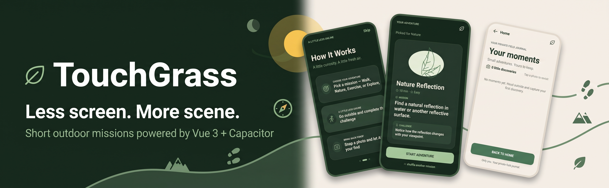
</p>

<p align="center">
  <strong>Less screen time. More green time.</strong><br />
  A mobile-first outdoor exploration app that turns going outside into small, rewarding adventures.
</p>

<p align="center">
  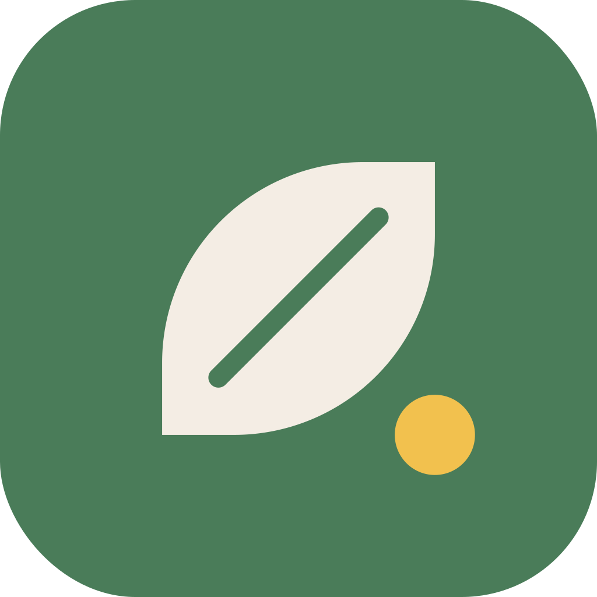
</p>

## About

TouchGrass encourages you to put down your phone and explore the world around you. Choose a mission, head outside, discover something new, and keep your memories as you progress.

- 🚶 **Walk** — Move around and notice your surroundings.
- 🌱 **Nature** — Discover natural objects with on-device AI image labeling.
- 🧭 **Explore** — Capture and save interesting discoveries.
- 📸 **Camera** — Capture discoveries and process photos on-device.
- ⭐ **Progress & Journal** — Track points, streaks, and saved memories.
- 🔊 **Sound feedback** — Get audio feedback for mission outcomes.
- 📱 **Mobile-first** — Built with Android in mind.

## Screenshots

### Sunlight

<p align="center">
  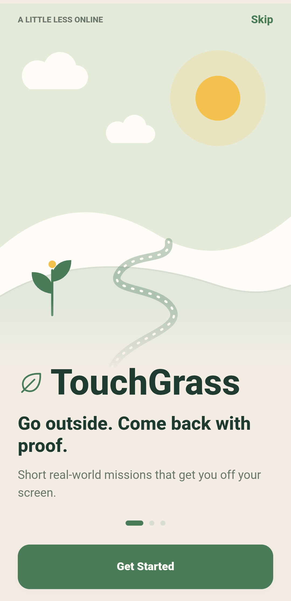
  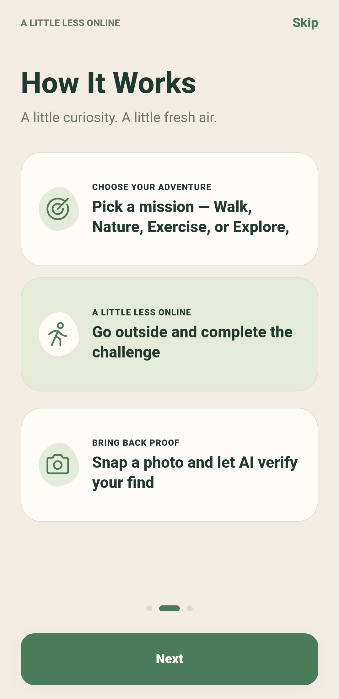
  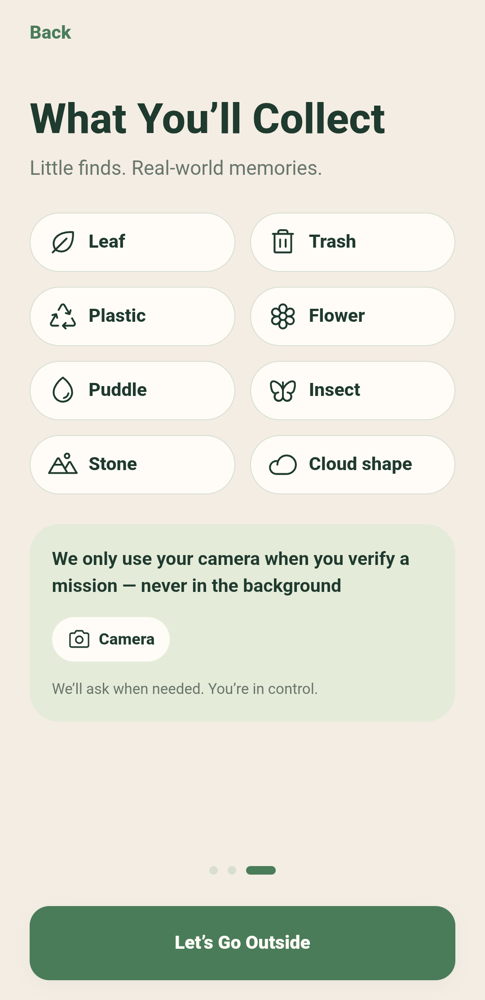
  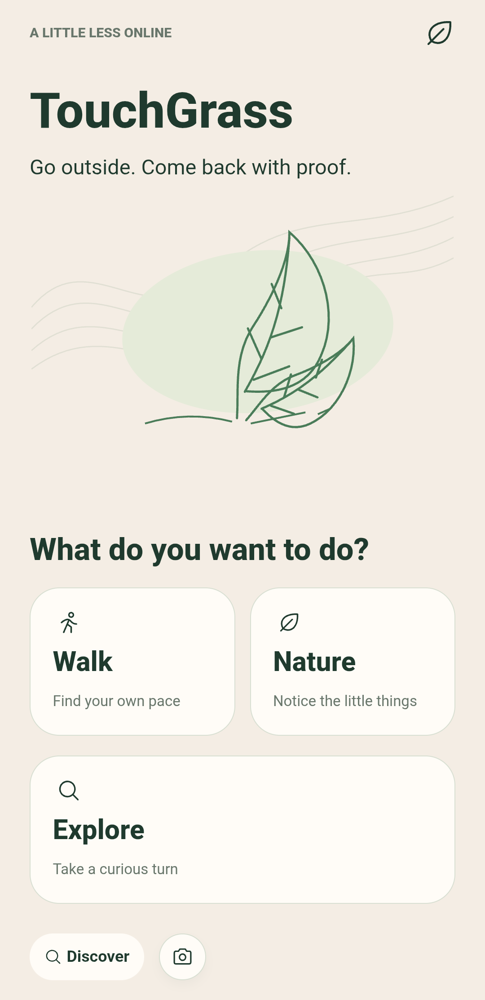
</p>

<p align="center">
  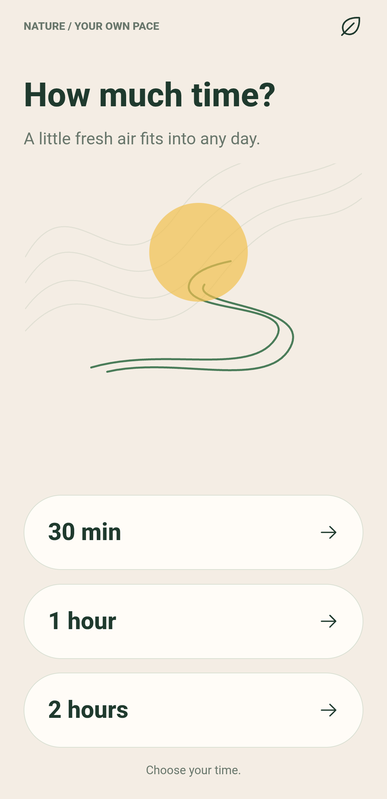
  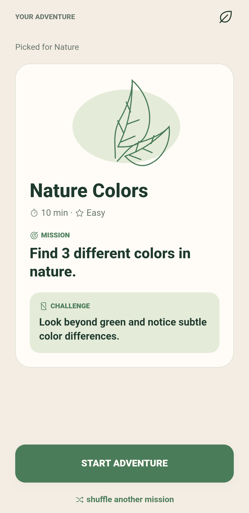
  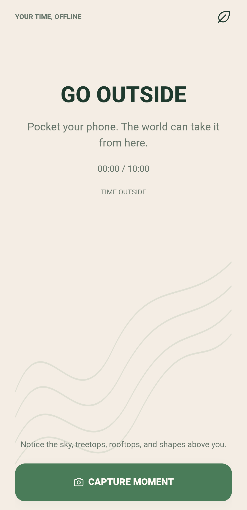
  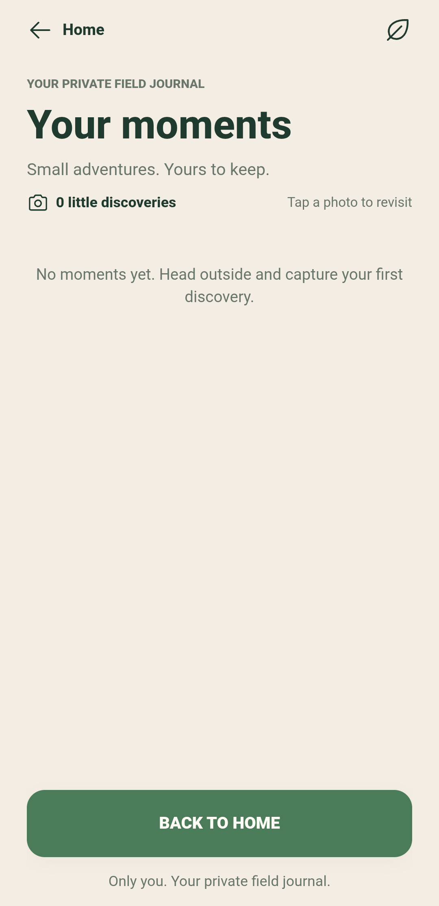
</p>

### Dusk

<p align="center">
  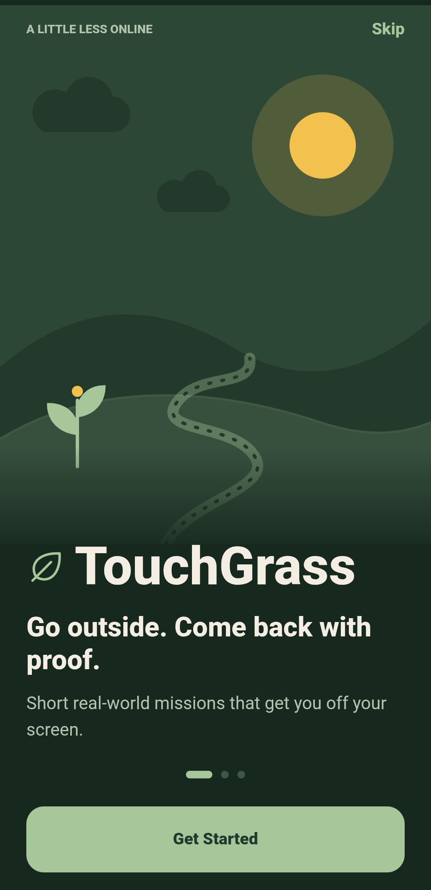
  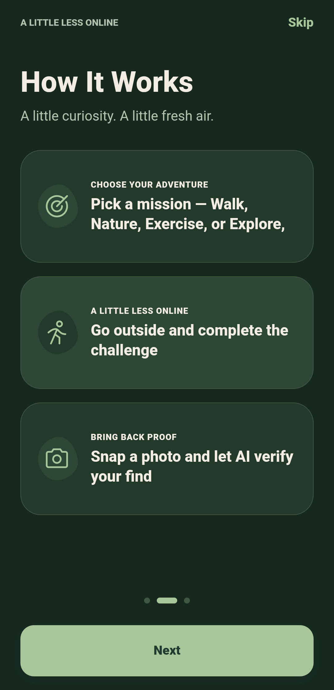
  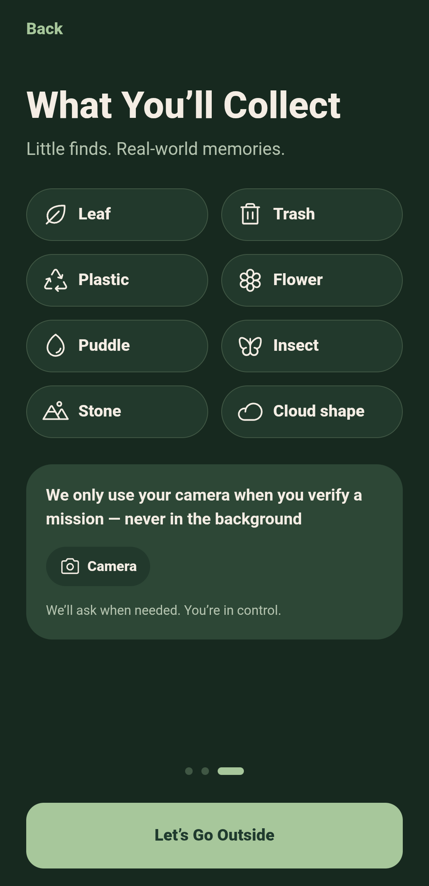
  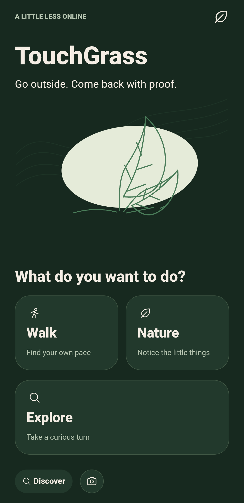
</p>

<p align="center">
  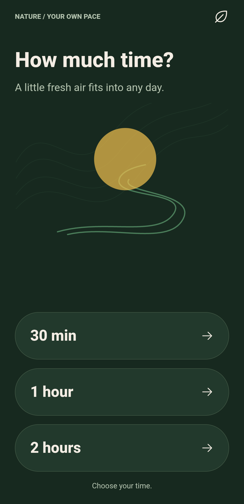
  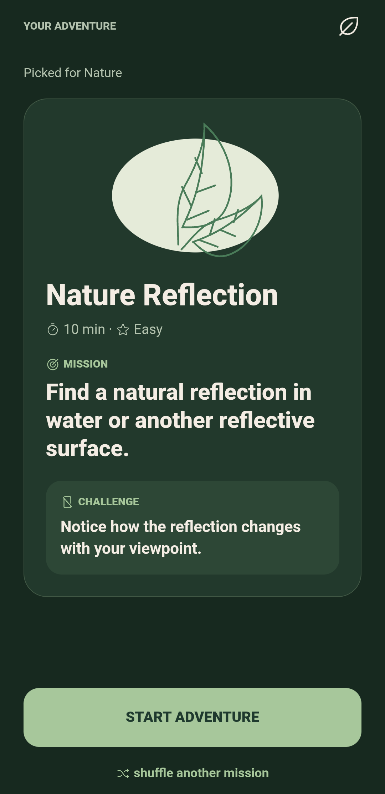
  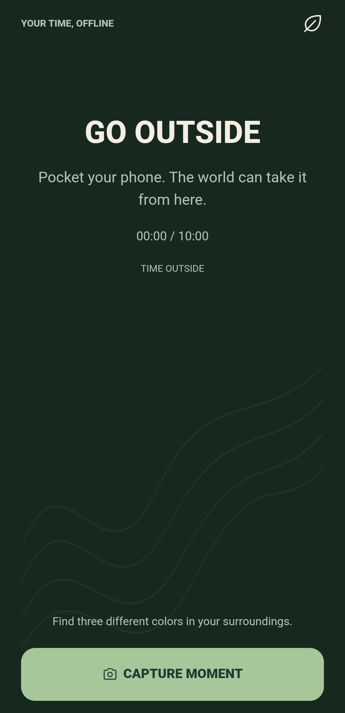
  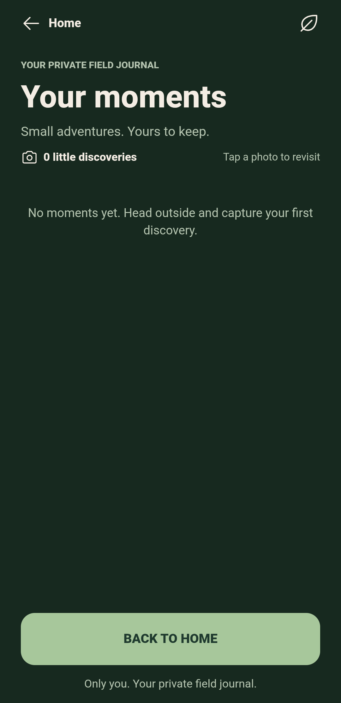
</p>

## Tech Stack

| Technology                      | Purpose                        |
| ------------------------------- | ------------------------------ |
| Vue 3                           | Reactive UI                    |
| Vite                            | Development and build tooling  |
| UnoCSS                          | Utility-first styling          |
| Vue Router                      | Navigation                     |
| Pinia                           | Application state              |
| Capacitor                       | Native Android runtime         |
| Capacitor ML Kit Image Labeling | On-device image classification |
| Capacitor Filesystem            | Local photo preparation        |
| Canvas API                      | Photo resizing and compression |

## Getting Started

```bash
# Install dependencies
npm install

# Start the development server
npm run dev

# Build for production
npm run build

# Sync the web build with Capacitor
npx cap sync android

# Open the Android project
npx cap open android
```

Use the scripts defined in `package.json` if your project uses a different package manager or command setup.

## Privacy & AI

TouchGrass is designed around local-first functionality. Photo compression and mission logic run on-device, while Nature uses native ML Kit image labeling through Capacitor. The app does not require a custom backend for its core mission flow.

Actual offline behavior depends on the installed native plugin and should be tested on the Android build.

## Philosophy

Technology should help us reconnect with the world, not keep us staring at a screen.

**TouchGrass — Go outside. Find something wonderful.** 🌿
